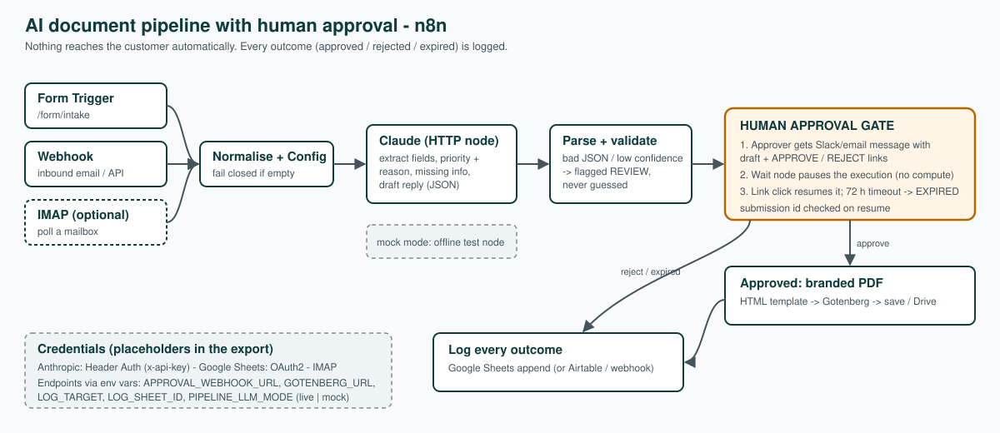

# AI Document Pipeline with Human Approval (n8n + Claude)

**Author:** Jordan De La Cruz · Brisbane, QLD · built October 2026 · all sample data is made up · MIT licence

> Portfolio piece, not a client project. Tested end to end in n8n with local stand-in services; see the test status below for exactly what has and hasn't been run against real services.

A customer request comes in through a form, an email or an API call. Claude pulls out the structured fields (category, priority with its reason, facts, missing information) and drafts a reply. A person gets APPROVE / REJECT links. Only after approval does the workflow render a branded PDF record. Every outcome is logged to Google Sheets, or to Airtable or any other webhook.

## What's in this folder

| File | What it is |
|---|---|
| `ai_document_pipeline_with_approval.n8n.json` | The importable workflow (23 nodes). Credentials are placeholders |
| `architecture.svg` | Architecture diagram |
| `sample/sample_input.json` | Made-up input (a cafe cool-room fault plus a quote request) |
| `sample/sample_claude_request.json` | The exact Messages API request the Claude node sends. The key is redacted |
| `sample/sample_approval_message.json` | The approval message, with the approve and reject links |
| `sample/sample_output_REQ-*.pdf` | The PDF produced after approval |
| `sample/sample_log_row.json` | The row written to the log |
| `TEST_REPORT.md` | What was tested, how, and what was not |
| `gen_workflow.py` | Generates the workflow JSON from source, so changes can be reviewed |
| `test_harness_stub_server.py` | Local stand-ins (Slack, Gotenberg, Anthropic, log) used only for offline testing |

## Design choices

- **Human in the loop by construction.** The workflow has no step that sends anything to the customer. The Wait node holds the execution until a person clicks a link. If nobody does within 72 hours, it logs `EXPIRED`. The submission id is checked when the workflow resumes.
- **Fail closed.** An empty submission stops the run. If the model returns bad JSON, a priority outside the allowed set, no draft, or confidence below 0.5, the record is flagged `REVIEW` and the approver sees the reasons. Nothing is guessed.
- **Prompt-injection hygiene.** The submission goes inside `<submission>` tags and is labelled as data, not instructions. The system prompt forbids inventing details.
- **No secrets in the workflow.** The Anthropic key is a Header Auth credential, Sheets uses OAuth2, and endpoints come from environment variables.
- **Mock mode.** `PIPELINE_LLM_MODE=mock` swaps the Claude call for a fixed offline node. You can demo or test the whole flow without an API key.

## Setup (about 15 minutes)

1. **Run n8n.** Use n8n 1.x, tested on 1.123.0 (`npx n8n` or the Docker image). On n8n 2.x, set `N8N_BLOCK_ENV_ACCESS_IN_NODE=false` or type the values straight into the **Config** node.
2. **Run Gotenberg** for HTML-to-PDF: `docker run -d -p 3000:3000 gotenberg/gotenberg:8`.
3. **Import** the JSON: Workflows → Import from file.
4. **Credentials:**
   - *Claude - Extract & Draft* → new **Header Auth** credential: Name `x-api-key`, Value = your Anthropic API key.
   - *Append to Google Sheet* → **Google Sheets OAuth2**. Make a sheet with a tab called `Log` and this header row: `submission_id, received_at, channel, name, email, company, category, priority, needs_review, missing_info, decision, decided_at, pdf_path, model, raw_message`.
   - *(Optional)* the IMAP trigger: enable it and add IMAP credentials.
5. **Environment variables** (or edit **Config**):

   | Var | Example |
   |---|---|
   | `PIPELINE_LLM_MODE` | `live` or `mock` |
   | `ANTHROPIC_MODEL` | `claude-sonnet-4-5` (any current Messages API model) |
   | `APPROVAL_WEBHOOK_URL` | A Slack incoming-webhook URL |
   | `GOTENBERG_URL` | `http://gotenberg:3000` |
   | `LOG_TARGET` | `sheets` or `webhook` |
   | `LOG_SHEET_ID` | The Google Sheet id |
   | `LOG_WEBHOOK_URL` | An Airtable automation webhook, or any other, when `LOG_TARGET=webhook` |
   | `PDF_OUTPUT_DIR` | A folder n8n is allowed to write to (see `N8N_RESTRICT_FILE_ACCESS_TO`) |
   | `WEBHOOK_URL` | The public base URL of your n8n. The approve/reject links are built from it |

6. **Activate** the workflow, then submit the form at `/form/intake`, or `POST` JSON `{name,email,company,message}` to `/webhook/intake-api`.

### Swapping parts
- **Approval by email instead of Slack:** replace *Notify Approver* with a Send Email or Gmail node and put `{{$json.approve_url}}` and `{{$json.reject_url}}` in the body.
- **.docx instead of PDF:** send a .docx template to Gotenberg's LibreOffice route (`/forms/libreoffice/convert`), or call a doc-generation API.
- **Airtable:** set `LOG_TARGET=webhook`, or replace the webhook node with the Airtable "Create record" node.

## Test status (summary)
I ran it end to end in a local n8n 1.123.0. Three paths passed: form → reject, webhook → approve → PDF → log, and the live-request path against a stand-in for the Anthropic API. In that test, Slack, Gotenberg, the log and the Anthropic API were all local stand-ins. **The workflow has not been tested against the real Anthropic API, real Slack, real Google Sheets or real Gotenberg.** It also has not been tested on n8n 2.x. Details are in `TEST_REPORT.md`.
